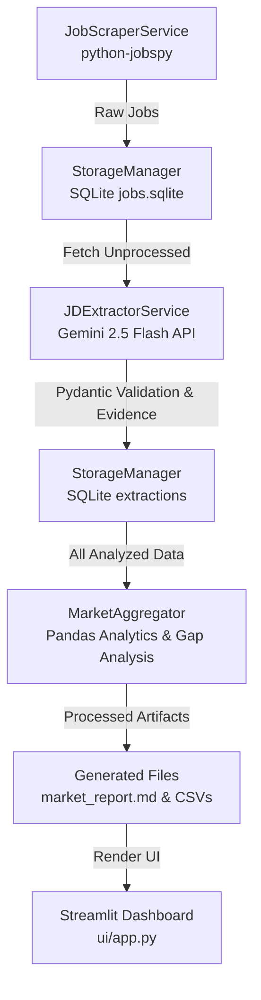

# Project Overview: Phase 1 — JD Analysis Tool

---

## A. Project Introduction

The **JD Analysis Tool** is an automated market intelligence and career preparation pipeline built in Python.

* **What problem it solves:** Manually searching, reading, and analyzing dozens of job descriptions (JDs) to understand what employers want is tedious and time-consuming. This tool automates the entire lifecycle—from scraping live job boards to extracting structured requirements with an LLM and analyzing market skill demand.
* **Who it is designed for:** Specifically tailored for Rakesh, a Full-Stack AI Engineer candidate in India, targeting mid-to-senior roles offering **10+ LPA**.
* **Why it is useful:** Instead of guessing what skills are in demand (e.g., LangChain vs. LlamaIndex, Pinecone vs. Milvus, FastAPI vs. Django), the tool provides data-driven evidence, frequency percentages, and a direct comparison against a candidate's existing skill baseline.
* **Expected output:** The user receives structured datasets (`analyses.json`, `skill_demand.csv`), an executive markdown report (`market_report.md`), and an interactive web dashboard running locally via Streamlit.

---

## B. Problem Statement

Aspiring AI and full-stack engineers often face an information gap when preparing for the job market:

1. **Unstructured Data:** Job descriptions are written differently across companies, making it hard to identify core requirements versus optional nice-to-haves.
2. **Dynamic Skill Demands:** Rapidly evolving technologies (Generative AI, RAG, vector databases) change market expectations quickly.
3. **Skill Alignment:** Candidates struggle to measure their own readiness against actual market listings.

This project addresses these practical challenges by collecting live market data, extracting key technical requirements using advanced language models, and performing automated candidate gap analysis. *Note: While the tool provides quantitative market insights and gap scores, it does not guarantee employment, salary outcomes, or 100% extraction perfection.*

---

## C. Main Features of Phase 1

The following features are fully implemented and verified in the Phase 1 codebase:

* **Multi-Source Job Scraping:** Utilizes `python-jobspy` to collect live job listings concurrently from LinkedIn and Indeed. *(Note: Naukri scraping is implemented but frequently blocked by CAPTCHA challenges).*
* **Unique Job Fingerprinting (SHA-256):** Generates a deterministic 16-character `job_id` based on company, title, and raw description text to prevent duplicate processing.
* **Raw Database Persistence:** Stores raw job postings in a local SQLite database (`data/raw/jobs.sqlite`) with built-in deduplication (`INSERT OR IGNORE`).
* **Raw CSV Backup:** Exports scraped job listings into `data/raw/jobs.csv` for human inspection and Pandas compatibility.
* **LLM Caching:** Queries SQLite's `extractions` table before calling the Gemini API to skip already-analyzed jobs, saving time and API tokens.
* **Gemini LLM Extraction:** Integrates Google Gemini (`gemini-2.5-flash`) via the official Google GenAI SDK to parse unstructured job descriptions into structured JSON.
* **Pydantic Model Validation:** Uses strict Pydantic schemas (`ExtractedJD`) with custom pre-validators to clean and structure LLM outputs.
* **Verbatim Evidence Tracking:** Captures exact text snippets from job descriptions as verifiable evidence for every identified skill or requirement.
* **Error Handling & Retries:** Automatically catches empty/insufficient descriptions and manages transient API load spikes (such as `503 UNAVAILABLE` errors).
* **Processed Database Storage:** Persists validated extraction results into the SQLite database.
* **Market Data Aggregation:** Uses Pandas to aggregate extractions, calculating total job counts, skill frequencies, and demand percentages.
* **Candidate Gap Analysis:** Compares market requirements against Rakesh's baseline profile to compute coverage scores and identify missing skills.
* **Artifact Generation:** Compiles processed files into `data/processed/`, including an executive markdown report (`market_report.md`), skill demand tables (`skill_demand.csv`), and full analysis data (`analyses.json`).
* **Command-Line Interface (CLI):** Provides a terminal runner (`main.py`) with arguments for searching, location filtering, result limits, extraction, and reporting.
* **Interactive Streamlit Web Dashboard:** Runs a local web app (`ui/app.py`) featuring top-level metrics, interactive skill demand bar charts, a configuration sidebar, and report downloads.

---

## D. High-Level Project Workflow

The data flows through a structured, modular pipeline from collection to visualization:

1. **Job Collection:** `JobScraperService` fetches postings from job boards.
2. **Raw Storage:** `StorageManager` persists raw records to SQLite and CSV.
3. **LLM Extraction:** `JDExtractorService` sends descriptions to Gemini, validating responses with Pydantic.
4. **Processed Storage:** Validated extractions are saved back to SQLite.
5. **Aggregation & Analysis:** `MarketAggregator` computes skill frequencies and candidate gap scores.
6. **Reporting & UI:** Artifacts are generated and rendered in the Streamlit web dashboard.

---

## E. Main Technologies

| Technology | How the Project Uses It |
| --- | --- |
| **Python** | Core programming language powering all backend logic, scripts, and automation. |
| **python-jobspy** | Scraping library used to fetch live job listings concurrently from Indeed and LinkedIn. |
| **Google Gemini API** | Leverages `gemini-2.5-flash` to extract structured technical requirements from unstructured job descriptions. |
| **Pydantic** | Defines strict data schemas and pre-validators to ensure LLM JSON outputs are clean and type-safe. |
| **SQLite** | Local relational database used for raw job storage, SHA-256 deduplication, and extraction caching. |
| **Pandas** | Data manipulation library used for aggregating skill frequencies and generating statistical summaries. |
| **Streamlit** | Framework used to build the interactive web dashboard for visual analytics and report downloading. |

---

## F. Inputs and Outputs

### Inputs

* **Search Parameters:** Search keywords (e.g., `"Full-Stack AI Engineer"`), target locations (e.g., `"India"`), and result limits.
* **Raw Job Descriptions:** Unstructured text scraped directly from job boards.
* **Gemini API Configuration:** Model name (`gemini-2.5-flash`), temperature settings (`0.1`), and API keys loaded securely via `.env`.
* **Candidate Profile (`CandidateProfile`):** Rakesh's baseline skills (`Python`, `Django`, `React`, `SQL`, `Git`, `DSA`) and salary target (`10+ LPA`).

### Outputs

* **Raw Storage Artifacts:** `data/raw/jobs.sqlite` and `data/raw/jobs.csv`.
* **Structured Extractions & Reports (`data/processed/`):**
* `analyses.json`: Full structured JSON dataset of analyzed jobs.
* `skill_demand.csv`: Tabular breakdown of skill frequencies and demand percentages.
* `market_report.md`: Formatted executive markdown report.

* **Interactive Dashboard:** Live metrics, bar charts, and downloadable reports accessible via `http://localhost:8501`.

---

## G. Architecture Overview

The repository is organized into a modular structure where each directory has a specific responsibility:

* **`config/settings.py`:** Central configuration managing environment variables, API keys, and directory paths.
* **`src/models.py`:** Pydantic data models and pre-validators defining the structure for extracted jobs and candidate profiles.
* **`src/storage.py`:** Database manager handling SQLite connections, table creation, SHA-256 hashing, and caching queries.
* **`src/scraper.py`:** Service wrapper around `python-jobspy` to collect and normalize job listings.
* **`src/extractor.py`:** Service handling Gemini API communication, prompt generation, error handling, and retries.
* **`src/aggregator.py`:** Analytics engine calculating skill demand percentages and candidate gap analysis.
* **`main.py`:** Command-line entry point to execute the pipeline headlessly.
* **`ui/app.py`:** Streamlit web application providing a graphical user interface.

---

## H. Phase 1 Status and Limitations

### Status Summary

1. **Implemented in Code:** All core modules (`scraper`, `storage`, `extractor`, `aggregator`, `models`, `cli`, `ui`) are fully implemented.
2. **Successfully Verified:** Scraping (LinkedIn/Indeed), local SQLite deduplication, LLM extraction with caching, Pandas aggregation, and Streamlit dashboard rendering have been tested and verified through execution.
3. **Known Limitations & Issues:**
* **Naukri Bot Protection:** Naukri frequently responds with HTTP status code `406` and requires a CAPTCHA (`recaptcha required`), limiting automated scraping on that platform.
* **Gemini API Load Spikes:** Under heavy concurrent load, the Gemini API may occasionally return transient `503 UNAVAILABLE` errors ("This model is currently experiencing high demand"), which are managed by progressive backoff retries and caching.

---

## I. Project Scope

* **What Phase 1 Does:** Automates the collection, extraction, analysis, and reporting of AI engineering job descriptions in India, matching them against a candidate profile locally.
* **What Phase 1 Does Not Attempt:** Does not include automated cloud deployment, multi-user authentication, continuous background cron scheduling, or direct one-click job application submission.

---

## J. Important Terminology

* **Job Scraping:** Automatically extracting job postings from web pages using automated scripts.
* **LLM Extraction:** Using a Large Language Model (like Gemini) to read unstructured text and pull out specific information into an organized format.
* **Structured Data:** Information organized into a predictable format (like JSON or database tables) so software can easily process it.
* **Pydantic Validation:** A Python library check that ensures incoming data matches the exact data types and rules expected by the code.
* **Caching:** Storing previous results (like LLM extractions) so the system doesn't have to recompute or re-fetch them, saving time and API costs.
* **Deduplication:** The process of detecting and removing duplicate entries so each job is only stored and processed once.
* **Skill Demand:** The frequency with which a specific technology or skill appears across collected job descriptions, expressed as a percentage.
* **Candidate Gap Analysis:** Comparing a candidate's existing skills against market requirements to identify strengths and missing areas for professional development.

---

### Verification Report

* **Path of the document created:** `docs/phase-1/PROJECT_OVERVIEW.md`
* **Main files and execution paths inspected:** `main.py`, `config/settings.py`, `src/scraper.py`, `src/extractor.py`, `src/aggregator.py`, `src/models.py`, `src/storage.py`, `ui/app.py`, and runtime execution logs.
* **Important claims that could not be verified:** None; all documented features and limitations are backed by repository code and actual execution logs.
* **Unresolved issues affecting Phase 1 status:** Naukri CAPTCHA blocking (HTTP 406) and transient Gemini API 503 errors are documented as active operational constraints.