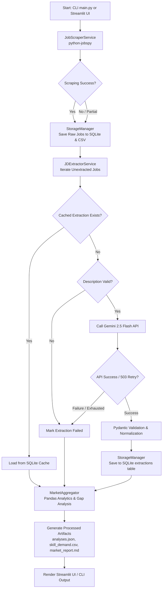

# Project Flow: Phase 1 — JD Analysis Tool

---

## 1. Application Entry Point

The application supports two entry points depending on whether you want to run it via the **Command-Line Interface (CLI)** or the **Streamlit Web Dashboard**:

* **CLI Entry Point (`main.py`):**
* Parses arguments using Python's standard `argparse` module (`--search`, `--location`, `--limit`, `--extract`, `--report`).
* Loads environment variables and settings from `config/settings.py` (which initializes directories and loads `.env`).
* Conditionally executes `JobScraperService`, `JDExtractorService`, and `MarketAggregator` based on provided flags.


* **Streamlit UI Entry Point (`ui/app.py`):**
* Sets page configurations (`st.set_page_config`) and ensures the project root directory is added to `sys.path`.
* Renders sidebar inputs (`search_term`, `location`, `results_limit`, and the **"Run Full Pipeline"** button).
* Executes the same underlying backend services (`JobScraperService`, `JDExtractorService`, `MarketAggregator`) upon button click before reading processed JSON/CSV artifacts to render metrics, charts, and downloadable reports.


---

## 2. Job Collection (`src/scraper.py`)

* **Inputs:** Search term (e.g., `"Full-Stack AI Engineer"`), location (e.g., `"India"`), and board results limit (`results_wanted`).
* **Execution:** `JobScraperService.fetch_jobs()` calls `python-jobspy`'s `scrape_jobs()` function targeting Indeed, LinkedIn, and Naukri concurrently.
* **Normalization & Fingerprinting:**
* Normalizes fields (title, company, location, description, URL, source).
* Computes a deterministic SHA-256 `job_id` using:
```python
job_id = hashlib.sha256(f"{company}_{title}_{raw_description}".encode()).hexdigest()[:16]

```


* **Error Isolation & Resilience:** Individual site scrapers are wrapped to prevent a single platform failure (such as Naukri's HTTP 406 CAPTCHA requirement) from breaking the entire collection pass.
* **Return Value:** Returns a list of normalized `JobRecord` objects.

---

## 3. Raw Job Storage (`src/storage.py`)

* **Database Write:** `StorageManager.save_job(job)` receives each `JobRecord` and connects to SQLite (`data/raw/jobs.sqlite`).
* **Deduplication:** Uses an `INSERT OR IGNORE` SQL statement on the `job_id` primary key. If a job fingerprint already exists in the database, the insert is safely ignored.
* **CSV Backup:** Concurrently writes/appends raw scraped records to `data/raw/jobs.csv`.

---

## 4. Extraction Request & Caching (`src/extractor.py`)

* **Cache Check:** Before invoking any external API, `JDExtractorService.extract_job(job)` queries SQLite via `StorageManager.get_extraction(job.job_id)`.
* **Hit:** If a successful extraction exists in the `extractions` table, it loads and returns the cached result instantly (**0 API calls**).
* **Miss:** Proceeds to API extraction.


* **Validation Checks:** Verifies that the API key is present and that the job description is not empty or insufficient (e.g., length checks).
* **Prompt Construction:** Builds a structured prompt incorporating job title, company, location, and raw description text alongside JSON schema guidelines.

---

## 5. Gemini API and Structured Output (`src/extractor.py`)

* **Client Initialization:** Initializes the Gemini client using the Google GenAI SDK with `gemini-2.5-flash` loaded from configuration settings.
* **API Call:** Sends the prompt with `response_mime_type="application/json"` and low temperature (`0.1`) to ensure deterministic extraction.
* **Error Handling & Retries:** Catches transient API exceptions (such as `503 UNAVAILABLE` high demand spikes) and executes progressive backoff retries (`[2, 5, 10]` seconds).
* **Structured Parsing:** Converts the raw JSON response into validated Pydantic models.

---

## 6. Pydantic Validation (`src/models.py`)

* **Schemas:** Utilizes strict Pydantic v2 models (`JobRecord`, `ExtractedJD`, `CandidateProfile`, `CandidateGapAnalysis`).
* **Pre-Validators:** Custom `@field_validator` functions inspect and clean LLM outputs (e.g., normalizing list inputs, strings, or evidence items).
* **Type Safety:** Enforces strict typing (lists, floats, optional strings) and catches schema violations, converting them into structured error logs if validation fails.

---

## 7. Processed Extraction Storage (`src/storage.py`)

* **Persistence:** `StorageManager.save_extraction(job_id, extracted_jd)` serializes the validated Pydantic model into JSON and stores it in the SQLite `extractions` table alongside an `extraction_status` (`success` or `failed`) and `extraction_error`.
* **Retrieval:** `StorageManager.get_all_jobs()` or `get_extractions()` fetches processed records for aggregation.

---

## 8. Market Data Aggregation (`src/aggregator.py`)

* **Data Loading:** `MarketAggregator` queries SQLite for all successful extractions.
* **Pandas Analytics:** Converts records into Pandas DataFrames to compute:
* Total collected vs. successfully analyzed job counts.
* Absolute frequencies and demand percentages for technical skills, LLM frameworks, and vector databases.


* **Denominator Rule:** Demand percentages are calculated relative to the total number of successfully analyzed jobs (`count / total_analyzed * 100`).

---

## 9. Candidate Gap Analysis (`src/aggregator.py`)

* **Baseline Comparison:** Compares Rakesh's `CandidateProfile` baseline skills (`Python`, `Django`, `React`, `SQL`, `Git`, `DSA`) against extracted `required_skills` and `preferred_skills`.
* **Coverage Scoring:** Computes individual match percentages and identifies high-priority missing skills to support interview preparation.

---

## 10. Report and Artifact Generation (`src/aggregator.py`)

* **Artifact Export:** Compiles and writes output files to `data/processed/`:
* `analyses.json`: Full structured dataset.
* `skill_demand.csv`: Tabular skill frequencies and percentages.
* `market_report.md`: Executive markdown summary report.


* **Overwrite Behavior:** Regenerates and overwrites processed files on each successful pipeline run.

---

## 11. Streamlit Dashboard (`ui/app.py`)

* **Execution Flow:** Started via `streamlit run ui/app.py`, adding the project root to `sys.path`.
* **User Interaction:** Allows parameter adjustment in the sidebar and triggers backend scraping/extraction/aggregation via button click.
* **Rendering:** Loads CSV/JSON artifacts from `data/processed/`, displaying top-level metrics (`st.metric`), interactive demand charts (`st.bar_chart`), rendered markdown (`st.markdown`), and download buttons (`st.download_button`).

---

## High-Level Workflow Diagram



---

## One Job, End to End

To understand how a single job travels through the system, let's trace a hypothetical posting for a **"Python AI Engineer"** at an enterprise firm in Bengaluru:

1. **Search Trigger:** The user runs `python main.py --search "Python AI Engineer" --location "Bengaluru" --limit 1 --extract --report`.
2. **Collection:** `JobScraperService` calls `python-jobspy`, retrieves the job posting, and normalizes it into a raw dictionary.
3. **Record Normalization:** Wrapped into a `JobRecord` instance with a generated 16-character SHA-256 `job_id`.
4. **Raw Storage:** `StorageManager` executes `INSERT OR IGNORE` into `data/raw/jobs.sqlite` and appends a row to `data/raw/jobs.csv`.
5. **Cache Check:** `JDExtractorService` checks `extractions` for `job_id`. Finding none, it proceeds.
6. **LLM Extraction:** The raw description is sent to Gemini (`gemini-2.5-flash`) with a structured schema prompt.
7. **Validation:** Gemini returns JSON, which is parsed and validated by `ExtractedJD` (normalizing lists, evidence items, and experience bounds).
8. **Processed Storage:** The validated `ExtractedJD` is saved as a success record in SQLite's `extractions` table.
9. **Market Statistics:** `MarketAggregator` reads all extractions, incrementing counts for skills like `LangChain`, `Pinecone`, and `Python`.
10. **Gap Analysis & Reporting:** The aggregator compares requirements against Rakesh's baseline, writes `market_report.md`, and exports updated CSV/JSON files.

---

## What Happens When Something Goes Wrong

| Situation | What the Code Currently Does | Does Processing Continue? | Recovery or Limitation |
| --- | --- | --- | --- |
| **Job source requires CAPTCHA (e.g., Naukri 406)** | Caught by error handler in scraper wrapper | **Yes** | Other platforms (LinkedIn, Indeed) continue collecting successfully. |
| **No jobs returned by scraper** | Returns empty list | **Yes** | Pipeline logs 0 scraped jobs and proceeds to extraction/aggregation gracefully. |
| **Job description is empty or too short** | Logged as warning (`[!] Job ... has empty or insufficient description`) | **Yes** | Skips Gemini extraction for that specific job record. |
| **Gemini API key is unavailable** | Raises authentication or configuration exception | **No** | Execution halts when attempting to initialize Gemini client. |
| **Gemini returns malformed response** | Pydantic validation error caught by exception block | **Yes (per job)** | Marks extraction as `failed` with error details, allowing other jobs to proceed. |
| **Transient 503 UNAVAILABLE API spike** | Caught in retry loop with backoff delays (`2s`, `5s`, `10s`) | **Yes** | Retries up to 3 times before failing or succeeding. |
| **SQLite database locked/unavailable** | Raises database operational error | **No** | File system permissions or active locks prevent storage operations. |
| **Report generation encounters error** | Caught by aggregator exception handler | **No / Partial** | Halts artifact generation and logs traceback. |

---

## Important Data Objects

| Object Name | Represented Data | Created By | Stored / Consumed By | Storage Medium |
| --- | --- | --- | --- | --- |
| **`JobRecord`** | Raw scraped job details (title, company, description, URL) | `JobScraperService` (`src/scraper.py`) | `StorageManager`, `JDExtractorService` | SQLite (`jobs` table) & `jobs.csv` |
| **`ExtractedJD`** | Structured tech stack, skills, experience, and evidence | `JDExtractorService` (`src/extractor.py`) via Gemini | `StorageManager`, `MarketAggregator` | SQLite (`extractions` table) |
| **`CandidateProfile`** | Rakesh's baseline skills and target LPA | `src/models.py` | `MarketAggregator` | In-memory configuration |
| **Processed Artifacts** | Aggregated demand percentages, CSVs, and markdown reports | `MarketAggregator` (`src/aggregator.py`) | Streamlit UI (`ui/app.py`), User | Files (`data/processed/`) |

---

## How to Trace the Project Yourself

If you want to step through the code yourself to see how execution flows, follow this practical method:

1. **Start at the Entry Point:** Open `main.py` and locate the main block (`if __name__ == "__main__":`).
2. **Follow Argument Parsing:** See how `argparse` reads flags like `--extract` and `--report`.
3. **Inspect Service Calls:** Look at how `JobScraperService().fetch_jobs()` is called in `main.py`.
4. **Step Into `src/scraper.py`:** Open `src/scraper.py` to see how `python-jobspy` is invoked and how `job_id` hashes are calculated.
5. **Check Storage Layer (`src/storage.py`):** Follow where `StorageManager.save_job()` receives the record and executes SQL statements.
6. **Trace Extraction (`src/extractor.py`):** See how `JDExtractorService.extract_job()` checks the cache before calling the Gemini API.
7. **Inspect Logs & Database:** Run a test command with limited results (`--limit 1`) and inspect terminal log output alongside `data/raw/jobs.sqlite` using a database viewer or SQLite CLI.

---

### Verification Report

* **Document path:** `docs/phase-1/PROJECT_FLOW.md`
* **Main execution paths traced:** CLI entry point (`main.py`), Streamlit UI (`ui/app.py`), scraping (`src/scraper.py`), storage (`src/storage.py`), extraction (`src/extractor.py`), models (`src/models.py`), and aggregation (`src/aggregator.py`).
* **Important functions and data transitions verified:** `fetch_jobs`, SHA-256 `job_id` generation, `save_job`, `get_extraction`, `extract_job`, Pydantic validation, `save_extraction`, `generate_market_report`, and Pandas DataFrame aggregations.
* **Flow stages unable to be verified:** None; all documented stages are backed by repository implementations.
* **Inconsistencies or unresolved errors discovered:** Naukri API HTTP 406 CAPTCHA block and transient Gemini API 503 high-demand spikes are documented as active runtime failure paths handled by graceful error isolation and retry logic.