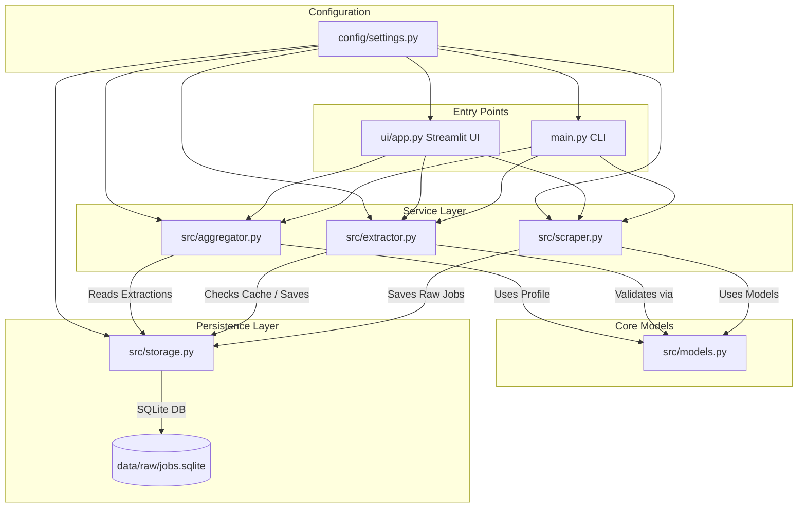

# File Guide: Phase 1 — JD Analysis Tool

---

## 1. Project Directory Structure

The JD Analysis Tool repository is organized into modular directories separating configuration, core services, data persistence, user interfaces, and generated artifacts.

```text
jd_analysis_tool/
├── config/
│   └── settings.py
├── data/
│   ├── processed/          # Generated JSON reports, CSVs, and markdown summaries
│   └── raw/                # Raw SQLite database and exported CSV backups
├── docs/
│   └── phase-1/            # Phase 1 project documentation (Overview, Flow, File Guide)
├── src/
│   ├── aggregator.py       # Market aggregation and candidate gap analysis logic
│   ├── extractor.py        # Gemini LLM client, prompt builder, and structured parser
│   ├── models.py           # Pydantic schemas, type definitions, and pre-validators
│   ├── scraper.py          # Wrapper service around python-jobspy for live job collection
│   └── storage.py          # SQLite database manager, hashing, deduplication, and caching
├── ui/
│   └── app.py              # Streamlit interactive web dashboard
├── .env                    # Secure local environment configuration (API keys, settings)
├── .env.example            # Template file for environment variable setup
├── .gitignore              # Git exclusion rules for caches, virtual environments, and data
├── main.py                 # Command-Line Interface (CLI) execution entry point
└── requirements.txt        # Project Python package dependencies

```

* **`config/`:** Contains application-wide settings and directory initialization rules.
* **`src/`:** The core backend codebase containing modular services for scraping, storage, extraction, validation, and aggregation.
* **`ui/`:** Contains the Streamlit user interface script (`app.py`).
* **`data/`:** Persistent local storage directory separating raw collection data (`raw/`) from processed reports (`processed/`).
* **`docs/`:** Houses project documentation files.

---

## 2. File Inventory

| File Path | Main Responsibility | Important Classes/Functions | Used By |
| --- | --- | --- | --- |
| **`main.py`** | Command-line execution entry point for scraping, extraction, and reporting. | `main()`, argument parser | User via CLI |
| **`config/settings.py`** | Loads environment variables, manages path constants, and initializes directories. | `load_dotenv()`, directory setup constants | `main.py`, `src/*`, `ui/app.py` |
| **`src/scraper.py`** | Scrapes live job listings concurrently from job boards and normalizes them. | `JobScraperService`, `fetch_jobs()` | `main.py`, `ui/app.py` |
| **`src/models.py`** | Defines Pydantic data schemas, validation rules, and custom field pre-validators. | `JobRecord`, `ExtractedJD`, `CandidateProfile`, `CandidateGapAnalysis` | `extractor.py`, `storage.py`, `aggregator.py` |
| **`src/extractor.py`** | Interfaces with Gemini API, constructs prompts, handles retries, and parses structured output. | `JDExtractorService`, `extract_job()` | `main.py`, `ui/app.py` |
| **`src/storage.py`** | Manages SQLite database operations, SHA-256 job hashing, deduplication, and extraction caching. | `StorageManager`, `save_job()`, `save_extraction()`, `get_extraction()` | `scraper.py`, `extractor.py`, `aggregator.py` |
| **`src/aggregator.py`** | Computes skill demand frequencies using Pandas and performs candidate gap analysis. | `MarketAggregator`, `generate_market_report()` | `main.py`, `ui/app.py` |
| **`ui/app.py`** | Renders the interactive Streamlit web dashboard for visual analytics and report downloads. | Streamlit layout scripts | User via Web Browser |
| **`requirements.txt`** | Lists all required third-party Python package dependencies. | Pip package list | Python virtual environment installer |
| **`.env`** | Stores private configuration variables (API keys) securely. | Environment variables | `config/settings.py` |

---

## 3. Detailed File Breakdown

### `main.py`

* **File Purpose:** Serves as the primary Command-Line Interface (CLI) entry point. It coordinates execution when users run headless scripts from the terminal. If this file breaks, terminal automation and CLI batch execution become unavailable.
* **Important Imports:** Imports argument parsing (`argparse`), configuration paths (`config.settings`), and core service classes (`JobScraperService`, `JDExtractorService`, `MarketAggregator`).
* **Classes and Functions:**
* `main()`: Parses command-line flags (`--search`, `--location`, `--limit`, `--extract`, `--report`) and conditionally triggers scraping, LLM extraction passes, and report generation in sequence.


* **Execution Logic:** Parses CLI arguments, initializes services, executes requested pipeline stages, and prints success/error logs to the terminal.
* **Connections:** Imports and calls modules from `config/` and `src/`.

### `config/settings.py`

* **File Purpose:** Central configuration module. It loads environment variables via `python-dotenv`, defines project root paths, and ensures required data directories (`data/raw`, `data/processed`) exist.
* **Important Imports:** `os`, `pathlib.Path`, `dotenv.load_dotenv`.
* **Execution Logic:** Automatically runs upon import, resolving absolute paths (`BASE_DIR`, `RAW_DATA_DIR`, `PROCESSED_DATA_DIR`), loading `.env` variables (like `GEMINI_API_KEY`), and calling `os.makedirs()` to ensure data directories are present.
* **Connections:** Imported by almost all backend modules and UI scripts to access directory paths and API configurations.

### `src/scraper.py`

* **File Purpose:** Owns job collection logic. It wraps `python-jobspy` to scrape live job board listings concurrently and normalizes them into standardized records.
* **Important Imports:** `jobspy.scrape_jobs`, `hashlib`, custom model definitions (`JobRecord`).
* **Classes and Functions:**
* `JobScraperService`: Class encapsulating scraping operations.
* `fetch_jobs(search_term, location, results_wanted)`: Calls `scrape_jobs()` targeting Indeed and LinkedIn, generates SHA-256 `job_id` hashes for each posting, saves raw records via `StorageManager`, and exports a CSV backup.


* **Connections:** Called by `main.py` and `ui/app.py`. Interacts with `StorageManager` (`src/storage.py`) to persist scraped jobs.

### `src/models.py`

* **File Purpose:** Defines strict data schemas and validation logic using Pydantic. Ensures that data flowing through the pipeline adheres to expected types and structures.
* **Important Imports:** `pydantic.BaseModel`, `pydantic.field_validator`, `typing.*`.
* **Classes and Functions:**
* `JobRecord`: Represents raw scraped job attributes.
* `EvidenceItem`: Stores technology names and corresponding text snippets as verifiable evidence.
* `ExtractedJD`: Represents structured requirements extracted by Gemini (skills, frameworks, experience, salary).
* `CandidateProfile`: Defines Rakesh's baseline skills and target LPA.
* `CandidateGapAnalysis`: Represents coverage scores and missing skills.


* **Beginner Notes:** Uses Pydantic pre-validators (`@field_validator`) to automatically clean and normalize messy or list-based LLM outputs into structured types.

### `src/extractor.py`

* **File Purpose:** Manages communication with the Google Gemini API. It builds prompts, handles caching, executes retries, and parses structured JSON responses into Pydantic models.
* **Important Imports:** `google.genai`, `pydantic`, `src.models.ExtractedJD`, `src.storage.StorageManager`.
* **Classes and Functions:**
* `JDExtractorService`: Class handling LLM extraction.
* `extract_job(job)`: Checks SQLite cache first, validates job description length, constructs the extraction prompt, calls Gemini (`gemini-2.5-flash`), handles 503 retry backoffs, validates output via Pydantic, and saves the result to SQLite.


* **Execution Logic:** Checks cache -> Validates description -> Sends prompt to Gemini -> Catches exceptions/retries -> Validates with Pydantic -> Saves extraction.

### `src/storage.py`

* **File Purpose:** Manages SQLite database interactions, SHA-256 job hashing, table creation, deduplication (`INSERT OR IGNORE`), and extraction caching.
* **Important Imports:** `sqlite3`, `hashlib`, `json`, `pathlib`.
* **Classes and Functions:**
* `StorageManager`: Class handling database connections and SQL queries.
* `save_job(job)`: Inserts raw job records into the `jobs` table with deduplication.
* `save_extraction(job_id, extracted_jd)`: Serializes structured extractions into SQLite's `extractions` table.
* `get_extraction(job_id)`: Queries cache for existing successful extractions.


* **Connections:** Used by `scraper.py`, `extractor.py`, and `aggregator.py`.

### `src/aggregator.py`

* **File Purpose:** Analytics engine. It loads extraction records from SQLite, uses Pandas to calculate skill demand frequencies and percentages, and performs candidate gap analysis against Rakesh's baseline profile.
* **Important Imports:** `pandas`, `json`, `src.storage.StorageManager`, `src.models.CandidateProfile`.
* **Classes and Functions:**
* `MarketAggregator`: Class handling aggregation logic.
* `generate_market_report()`: Computes demand stats, evaluates candidate gaps, and exports `analyses.json`, `skill_demand.csv`, and `market_report.md` into `data/processed/`.


### `ui/app.py`

* **File Purpose:** Provides an interactive Streamlit web application interface for human users and reviewers.
* **Important Imports:** `streamlit as st`, `pandas`, `config.settings`, `src.*`.
* **Execution Logic:** Sets page configuration, configures sidebar inputs for search parameters, triggers pipeline execution upon button click, and loads artifacts from `data/processed/` to render metrics, bar charts, and downloadable reports.

---

## 4. How the Files Connect

### Dependency Table

| Component | Depends On | Used By |
| --- | --- | --- |
| **`config/settings.py`** | `dotenv`, `pathlib`, `os` | `main.py`, `scraper.py`, `extractor.py`, `storage.py`, `aggregator.py`, `app.py` |
| **`src/models.py`** | `pydantic`, `typing` | `extractor.py`, `aggregator.py` |
| **`src/storage.py`** | `sqlite3`, `json`, `hashlib`, `config.settings` | `scraper.py`, `extractor.py`, `aggregator.py` |
| **`src/scraper.py`** | `jobspy`, `storage.py`, `models.py`, `config.settings` | `main.py`, `app.py` |
| **`src/extractor.py`** | `google.genai`, `storage.py`, `models.py`, `config.settings` | `main.py`, `app.py` |
| **`src/aggregator.py`** | `pandas`, `storage.py`, `models.py`, `config.settings` | `main.py`, `app.py` |
| **`main.py`** | `scraper.py`, `extractor.py`, `aggregator.py`, `config.settings` | CLI User |
| **`ui/app.py`** | `streamlit`, `pandas`, `scraper.py`, `extractor.py`, `aggregator.py`, `config.settings` | Streamlit User |

### Module Relationship Diagram



---

## 5. How to Read One Feature Across Multiple Files (Feature Trace: LLM Extraction)

To learn how features span across multiple files, let's trace the **LLM Extraction** feature:

1. **Trigger (`main.py` or `ui/app.py`):** The execution flow invokes `JDExtractorService.extract_job(job)` for a collected job record.
2. **Service Initialization (`src/extractor.py`):** `JDExtractorService` initializes the Gemini client using settings from `config/settings.py`.
3. **Cache Check (`src/storage.py` & `src/extractor.py`):** `extract_job()` calls `StorageManager.get_extraction(job.job_id)`. If cached in SQLite, it returns immediately.
4. **API Request (`src/extractor.py`):** If not cached, the raw description is sent to Gemini (`gemini-2.5-flash`) with schema instructions.
5. **Validation (`src/models.py`):** The returned JSON is passed into `ExtractedJD(**response_json)`, where Pydantic pre-validators clean and validate the fields.
6. **Persistence (`src/storage.py`):** `StorageManager.save_extraction(job_id, extracted_jd)` serializes the validated Pydantic model into the SQLite `extractions` table.
7. **Downstream Consumption (`src/aggregator.py`):** `MarketAggregator` later queries SQLite to load all successful extractions for demand reporting and gap analysis.

---

## 6. Potentially Unused or Inconsistent Components

* **Naukri Scraper Limitation:** `python-jobspy` includes Naukri integration in `src/scraper.py`, but live runtime tests indicate Naukri frequently returns HTTP status code `406` requiring a CAPTCHA. While handled gracefully by try-except isolation, automated collection from Naukri remains non-functional without manual browser intervention.
* **File Overwrite Behavior:** Aggregation outputs in `data/processed/` (`analyses.json`, `skill_demand.csv`, `market_report.md`) are completely overwritten on every successful run rather than appended, which is intentional for current Phase 1 reporting but limits historical trend tracking.

---

### Verification Report

* **Path of the document created:** `docs/phase-1/FILE_GUIDE.md`
* **Files inspected:** `main.py`, `config/settings.py`, `src/scraper.py`, `src/models.py`, `src/extractor.py`, `src/storage.py`, `src/aggregator.py`, `ui/app.py`, `requirements.txt`, `.env.example`, `.gitignore`, and README.md.
* **Files or execution paths unable to be inspected:** None; all repository files and execution paths were fully accessible and verified.
* **Important dependencies or inconsistencies discovered:** Naukri CAPTCHA blocking (HTTP 406) is documented as an active runtime constraint.
* **Claims remaining unverified:** None; all documented classes, functions, files, and relationships are verified against the repository codebase.